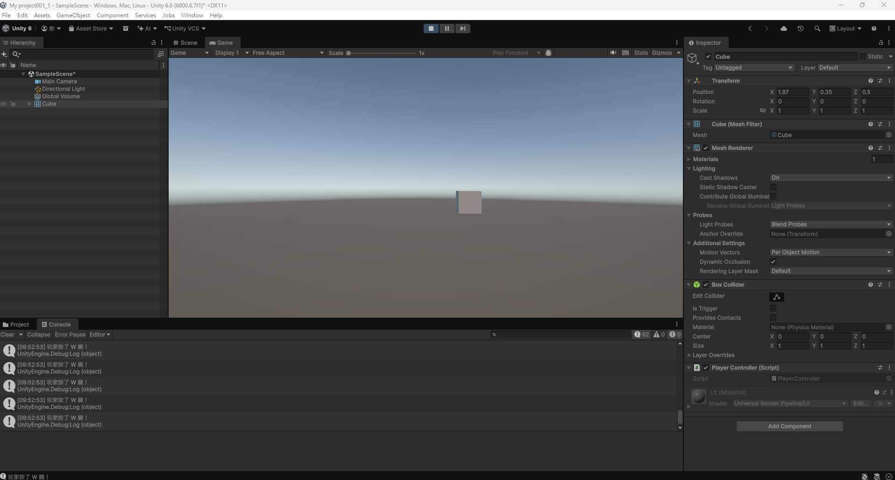
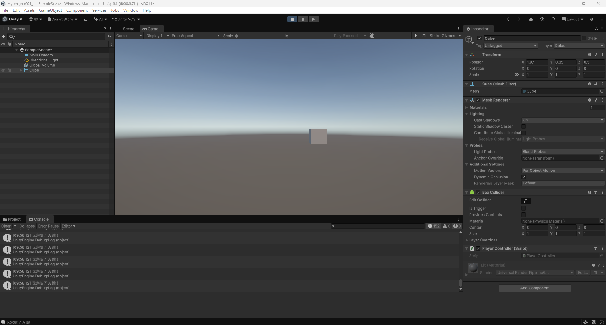
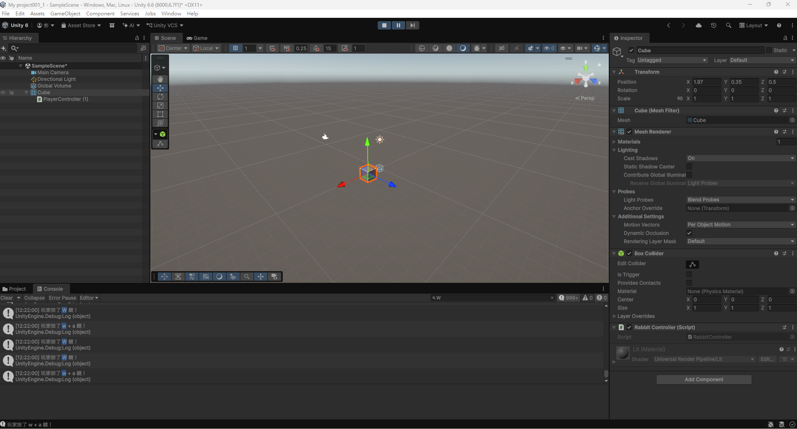
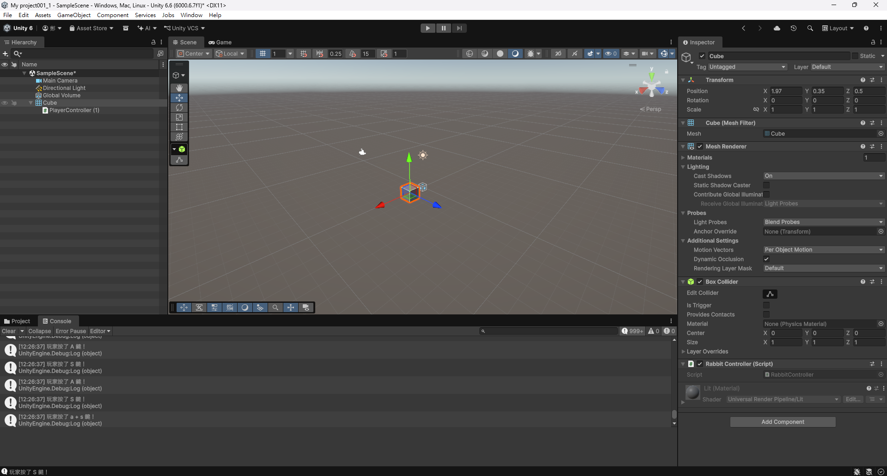
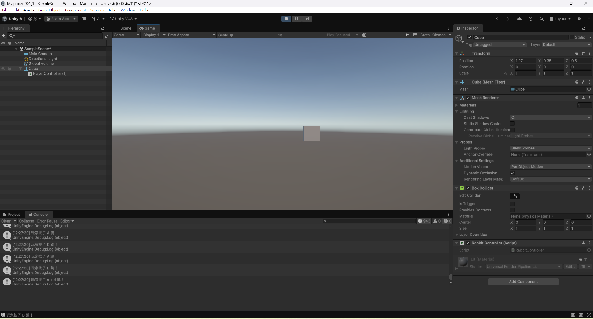
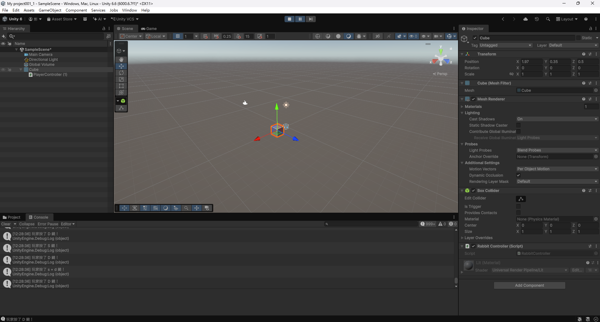

# 第2次作業題目-作業-HW2
>
>學號：113111128 (換成自己的)
><br />
>姓名：鄭姵妤 (換成自己的)
><br />
>作業撰寫時間： 80(mins，包含程式撰寫時間，換成自己的)
><br />
>最後撰寫文件日期：2026/10/29 (換成自己的)
>

本份文件包含以下主題：(至少需下面兩項，若是有多者可以自行新增)
- [x] 說明內容
- [x] 其他 (可以包含心得或是想跟老師反映)

## 說明內容

開始寫說明，該說明需說明想法，
並於之後再對上述想法的每一部分將程式進一步進行展現，
若需引用程式區則使用下面方法，
若為.cs檔內程式除了於敘述中需註明檔案名稱外，
還需使用語法` ```語言種類 程式碼 ``` `，其中語言種類若是要用python則使用py，java則使用java，C/C++則使用cpp，
下段程式碼為語言種類選擇csharp使用後結果：

```csharp
public void mt_getResult(){
    ...
}
```

若要於內文中標示部分網頁檔，則使用以下標籤` ```html 程式碼 ``` `，
下段程式碼則為使用後結果：

```html
<%@ Page Language="C#" AutoEventWireup="true" ...>

<!DOCTYPE html>

<html xmlns="http://www.w3.org/1999/xhtml">
<head runat="server">
<meta http-equiv="Content-Type" ...>
    <title></title>
</head>
<body>
    <form id="form1" runat="server">
        <div>
        </div>
    </form>
</body>
</html>
```
更多markdown方法可參閱[https://ithelp.ithome.com.tw/articles/10203758](https://ithelp.ithome.com.tw/articles/10203758)

請在撰寫"說明程式與內容"該塊內容，請把原該塊內上述敘述刪除，該塊上述內容只是用來指引該怎麼撰寫內容。

1. 
Ans:
    a.using UnityEngine;
// 匯入 InputSystem 套件，用來偵測玩家按鍵
using UnityEngine.InputSystem;

public class PlayerMove : MonoBehaviour
{
    void Update()
    {
        // 取得現在鍵盤的狀態
        Keyboard keyboard = Keyboard.current;
        if (keyboard == null) return;

        // 偵測玩家有沒有按 W 鍵
        if (keyboard.wKey.isPressed)
        {
            Debug.Log("玩家按了 W 鍵！");
        }

        // 偵測玩家有沒有按 A 鍵
        if (keyboard.aKey.isPressed)
        {
            Debug.Log("玩家按了 A 鍵！");
        }

        // 偵測玩家有沒有按 S 鍵
        if (keyboard.sKey.isPressed)
        {
            Debug.Log("玩家按了 S 鍵！");
        }

        // 偵測玩家有沒有按 D 鍵
        if (keyboard.dKey.isPressed)
        {
            Debug.Log("玩家按了 D 鍵！");
        }
    }
}


2. 
Ans:
 b. 
Ansusing UnityEngine;
using UnityEngine.InputSystem;

public class PlayerMove : MonoBehaviour
{
    void Update()
    {
        // 取得現在鍵盤的狀態
        Keyboard keyboard = Keyboard.current;
        // 如果找不到鍵盤裝置則直接返回，避免程式報錯
        if (keyboard == null) return;

        // --- 1. 單鍵偵測 ---
        //偵測玩家是否有按 W 鍵
          
        if (keyboard.wKey.isPressed) { Debug.Log("玩家按了 W 鍵！"); }
        // 偵測玩家是否有按 A 鍵
         
        if (keyboard.aKey.isPressed) { Debug.Log("玩家按了 A 鍵！"); }
        // 偵測玩家是否有按 S 鍵
        
        if (keyboard.sKey.isPressed) { Debug.Log("玩家按了 S 鍵！"); }
        // 偵測玩家是否有按 D 鍵
        
        if (keyboard.dKey.isPressed) { Debug.Log("玩家按了 D 鍵！"); }

        // --- 2. 複合鍵偵測 (當雙鍵同時按) ---
        利用 && (AND) 運算子同時判斷兩個按鍵是否都被按下
        // 偵測 W + A 複合鍵
        if (keyboard.wKey.isPressed && keyboard.aKey.isPressed) { Debug.Log("玩家按了 w + a 鍵！"); }
        // 偵測 W + S 複合鍵
        if (keyboard.wKey.isPressed && keyboard.sKey.isPressed) { Debug.Log("玩家按了 w + s 鍵！"); }
        // 偵測 W + D 複合鍵
        if (keyboard.wKey.isPressed && keyboard.dKey.isPressed) { Debug.Log("玩家按了 w + d 鍵！"); }
        // 偵測 A + S 複合鍵
        if (keyboard.aKey.isPressed && keyboard.sKey.isPressed) { Debug.Log("玩家按了 a + s 鍵！"); }
        // 偵測 A + D 複合鍵
        if (keyboard.aKey.isPressed && keyboard.dKey.isPressed) { Debug.Log("玩家按了 a + d 鍵！"); }
        // 偵測 S + D 複合鍵
        if (keyboard.sKey.isPressed && keyboard.dKey.isPressed) { Debug.Log("玩家按了 s + d 鍵！"); }
        只要把程式碼裡的 wKey、aKey、sKey、dKey 換成自已想偵測的其他按鍵英文名稱就可以了任意搭配
    }
}
W + A 複合鍵執行結果：

W + S 複合鍵執行結果：

W + D 複合鍵執行結果：

A + S 複合鍵執行結果： 

A + D 複合鍵執行結果： 

S + D 複合鍵執行結果： 


        
## 其他
研究很久花很多時間才看懂才完成的作業，上課有點難希望可以越來越好，有點跟不太上有些步驟課本沒有謝謝老師!!!